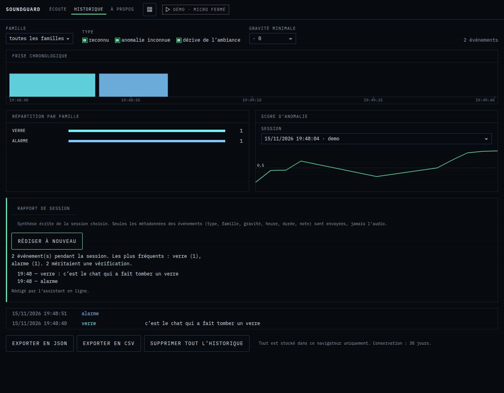
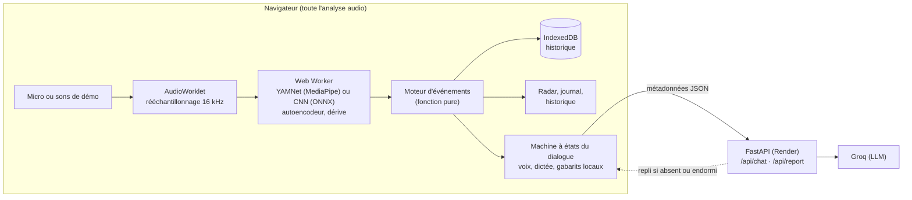

# SoundGuard AI

[](https://github.com/JAAFOURAMouez/sound_detection/actions/workflows/ci.yml)
[](https://github.com/JAAFOURAMouez/sound_detection/actions/workflows/deploy.yml)

Poste d'écoute acoustique dans le navigateur : il classe les sons de la pièce, remarque ce qui
est inhabituel même sans l'avoir appris, puis **prend lui-même la parole** pour expliquer ce
qu'il a entendu et recommander une action.

**Démo en ligne : <https://jaafouramouez.github.io/sound_detection/>** — le bouton
« Essayer sans micro » rejoue des sons d'exemple : aucun micro, aucun compte, aucun serveur requis.


## Ce que fait l'application

1. **Consentement** : rien n'est écouté avant ton accord ; un indicateur « micro actif » reste visible.
2. **Calibration** : quelques secondes de calme pour apprendre le bruit normal de la pièce.
3. **Écoute** : classification (YAMNet ou CNN maison) et score d'anomalie toutes les 0,5 s,
   affichés sur un radar, un spectrogramme et un journal.
4. **Dialogue** : sur un événement notable, l'assistant parle (synthèse vocale), écoute ta
   réponse (dictée ou clavier), comprend quand tu donnes l'origine du son (« c'est le chat ») et
   la note dans le journal. Il se tait pendant sa propre parole pour ne pas s'entendre.
5. **Historique** : frise, répartition par famille, courbe du score, réécoute des extraits,
   export JSON/CSV et **rapport de session** rédigé par le LLM.



## Vie privée

- **L'audio ne quitte jamais le navigateur** : capture, rééchantillonnage, classification et
  score d'anomalie tournent sur l'appareil (AudioWorklet + Web Worker, WASM).
- Le serveur ne reçoit que des **métadonnées d'événements** (type, famille, gravité, heure,
  durée) pour le dialogue et le rapport, jamais de son.
- L'historique est stocké dans IndexedDB, dans ce navigateur seulement (30 jours), et les
  extraits de réécoute restent en mémoire vive.
- La clé du LLM vit uniquement dans les variables d'environnement du serveur ; la CI vérifie
  qu'aucun secret ne se trouve dans le bundle publié.

## Architecture



| Brique | Rôle | Hébergement (gratuit) |
|---|---|---|
| Frontend React + TypeScript | interface, audio, inférence, historique | GitHub Pages |
| Modèles (YAMNet 4,1 Mo, CNN 4,5 Mo, autoencodeur 1,4 Mo) | servis en statique, mis en cache (Cache API) | GitHub Pages |
| Backend FastAPI (~75 Mo de RAM, sans PyTorch) | validation, limite de débit, appel au LLM, repli | Render, offre gratuite |
| LLM | formulation des réponses et du rapport | Groq, offre gratuite |

Coût total : **0 €**, sans carte bancaire. Le serveur gratuit s'endort après 15 min sans
trafic : la page l'appelle dès l'ouverture, et tant qu'il ne répond pas l'assistant utilise des
réponses locales (indicateur « hors ligne » discret).

## Métriques mesurées

Évaluation sur ESC-50 (2 000 clips, 50 classes), validation croisée sur les **5 plis officiels**
(jamais mélangés). Détails, matrices de confusion et protocoles : [`ml/reports/`](ml/reports/).

| Modèle | Exactitude (clip) | F1 macro | Exactitude (fenêtre 1 s) | Taille |
|---|---|---|---|---|
| CNN maison (850 k paramètres, log-mel dans le graphe ONNX) | 82,8 ± 1,6 % | 81,8 ± 1,6 % | 69,4 ± 2,0 % | 4,5 Mo |
| YAMNet + régression logistique (référence) | 81,2 ± 1,9 % | 81,3 ± 1,9 % | — | 4,1 Mo |

Détection d'anomalies (autoencodeur, 1,4 Mo) : 8 classes jamais vues à l'entraînement contre
42 classes « ordinaires ». AUC-ROC par fenêtre de 1 s (le cas du navigateur) : **0,627** avec la
règle du navigateur (le plus grand des deux scores normalisés, sur leur logarithme : erreur de
reconstruction et distance des embeddings à la ligne de base), contre 0,578 pour la distance seule
et 0,520 pour la reconstruction seule ; par clip : 0,671 ± 0,018. C'est un résultat modeste,
sur un protocole plus difficile que l'usage réel (la « normalité » y couvre 42 classes très
différentes, au lieu de l'ambiance d'une seule pièce).

Dans le navigateur, sur une ambiance calme réelle calibrée pendant 60 s (salle d'étude, 11,9 min
surveillées) : **0 fausse alerte** ; un bris de verre injecté 10 dB au-dessus de l'ambiance déclenche
une alerte en 1 s, mais avec une marge très faible (score lissé 0,503 pour un seuil de 0,5, contre
0,497 au maximum sur l'ambiance seule). Un choc sourd au même niveau n'est pas détecté.

Parité PyTorch / ONNX Runtime (Python) / ONNX Runtime Web sur les mêmes fenêtres réelles : écart
maximal 4,3 × 10⁻⁶ (tolérance 10⁻³).

Dans le navigateur (mesures des tests de bout en bout) : étiquette affichée **450 ms** en médiane
après le début du son (max 890 ms) ; interface à **57 à 60 images/s** pendant l'écoute avec
500 événements ; bundle initial **131 Ko** compressé ; accessibilité Lighthouse **100**, aucune
violation axe (WCAG 2.1 AA) dans les deux thèmes, à 1280 et 380 px.

## Limites

- **Ce n'est pas un dispositif de sécurité certifié** : un son peut être manqué, et une alerte peut être fausse.
- La détection d'anomalies reste modeste (AUC 0,627 par fenêtre) : elle repère bien un bruit
  fort et nouveau dans une pièce calme, mal un choc sourd au niveau de l'ambiance.
- Les modèles maison sont entraînés sur ESC-50 (CC BY-NC) : **usage non commercial uniquement**.
- La dictée vocale dépend du navigateur (absente de Firefox) et passe par le service de
  reconnaissance de ce navigateur ; le clavier reste toujours disponible.
- Premier échange lent si le serveur dormait (environ une minute), sans bloquer l'interface.
- Testé sur Chromium (ordinateur et téléphone émulé) ; Safari n'a pas été vérifié.

## Pistes

- Mode précision : modèle AST via Transformers.js et WebGPU pour ré-analyser un événement.
- Cas « machine d'atelier » avec un sous-ensemble MIMII / DCASE Task 2.
- Application installable (PWA) et fonctionnement hors ligne complet.
- Interface en anglais (les textes passent déjà tous par `src/i18n`).

## Démarrage local

Prérequis : Node.js 24 (voir `frontend/.nvmrc`), Python 3.11+ et [uv](https://docs.astral.sh/uv/).

```bash
# frontend
cd frontend
npm ci
npm run dev          # serveur de développement (http://localhost:5173)
npm run build        # vérification des types puis build de production
npm test             # tests Vitest
npm run lint         # ESLint
npm run typecheck    # TypeScript strict
npm run format       # Prettier

# backend
cd backend
uv sync
uv run uvicorn app.main:app --reload   # http://localhost:8000/api/health
uv run pytest
uv run ruff check . && uv run ruff format --check .

# ml
cd ml
uv sync              # dépendances d'entraînement (PyTorch…) : uv sync --extra train, à partir de la phase 3
uv run pytest
uv run ruff check .
```

La configuration d'exemple se trouve dans `.env.example`.

Le test du site publié (navigateur vierge, ordinateur et téléphone, serveur bloqué) se lance
avec `cd frontend && npm run test:public` (variable `PUBLIC_URL` pour viser une autre adresse).

## Déploiement

Le frontend est publié automatiquement sur GitHub Pages quand la CI est verte sur `main`
(`.github/workflows/deploy.yml`), puis vérifié en ligne par Playwright. Le backend est décrit
par `render.yaml` (blueprint Render) ; la clé `GROQ_API_KEY` se saisit dans le tableau de bord
Render, jamais dans le dépôt. Détails : [`docs/DEPLOYMENT.md`](docs/DEPLOYMENT.md).

## Documents

| Fichier | Contenu |
|---|---|
| `docs/SPEC.md` | Fonctionnalités, scénario, règles de l'assistant |
| `docs/ARCHITECTURE.md` | Chaîne audio, modèles, anomalies, backend, tests |
| `docs/DESIGN.md` | Direction visuelle « poste d'écoute » |
| `docs/ROADMAP.md` | Phases et critères d'acceptation |
| `docs/DEPLOYMENT.md` | Mise en ligne gratuite |

## Licences

- Code : aucune licence n'est encore attachée au dépôt (tous droits réservés par défaut).
- YAMNet : Apache-2.0 (Google). ONNX Runtime Web : MIT. MediaPipe Tasks : Apache-2.0.
  Polices IBM Plex : SIL Open Font License.
- Les modèles maison sont entraînés sur ESC-50 (K. J. Piczak), sous licence **CC BY-NC 3.0** :
  ils sont réservés à un usage non commercial.
- Sons de démonstration (domaine public et CC BY 4.0) : auteurs et sources dans
  [`frontend/public/samples/SAMPLES.md`](frontend/public/samples/SAMPLES.md).
