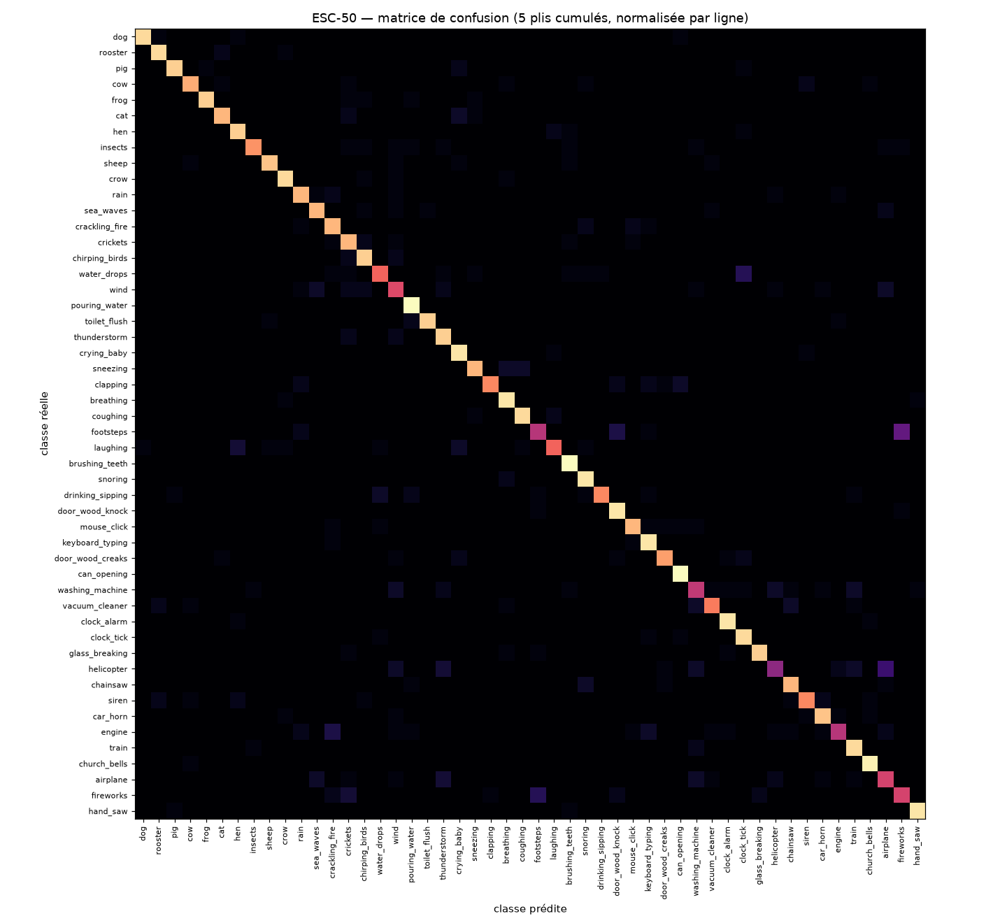

# Classifieur CNN — validation croisée ESC-50

Révision `6a68c96` · 120 époques · 850,258 paramètres · appareil `cuda`.

Protocole : 5 plis officiels d'ESC-50, jamais mélangés ; chaque pli sert une fois de test.
Entrée du modèle : fenêtres de 1 s à 16 kHz. Prédiction par clip = moyenne des probabilités
des fenêtres sonores (pas de 0,5 s). L'exactitude « par fenêtre » est celle d'une fenêtre
isolée, comme dans le navigateur.

| Pli | Exactitude (clip) | F1 macro (clip) | Exactitude (fenêtre 1 s) |
|---|---|---|---|
| 1 | 83.2 % | 82.2 % | 68.3 % |
| 2 | 81.5 % | 80.6 % | 69.0 % |
| 3 | 83.0 % | 82.2 % | 69.0 % |
| 4 | 85.5 % | 84.4 % | 73.2 % |
| 5 | 81.0 % | 79.6 % | 67.6 % |
| **moyenne ± écart-type** | **82.8 % ± 1.6 %** | **81.8 % ± 1.6 %** | **69.4 % ± 2.0 %** |

## Classes les plus difficiles (exactitude par clip, 5 plis)

| Classe | Exactitude |
|---|---|
| helicopter | 40.0 % |
| footsteps | 50.0 % |
| engine | 50.0 % |
| washing_machine | 52.5 % |
| airplane | 57.5 % |
| fireworks | 57.5 % |
| wind | 60.0 % |
| water_drops | 67.5 % |

## Confusions les plus fréquentes

| Réelle | Prédite | Clips |
|---|---|---|
| footsteps | fireworks | 12 |
| helicopter | airplane | 8 |
| fireworks | footsteps | 6 |
| water_drops | clock_tick | 6 |
| engine | crackling_fire | 5 |
| footsteps | door_wood_knock | 5 |
| fireworks | crickets | 4 |
| laughing | hen | 4 |
| helicopter | thunderstorm | 4 |
| airplane | thunderstorm | 4 |

Licence des données : ESC-50, CC BY-NC 3.0 — modèle réservé à un usage non commercial.
